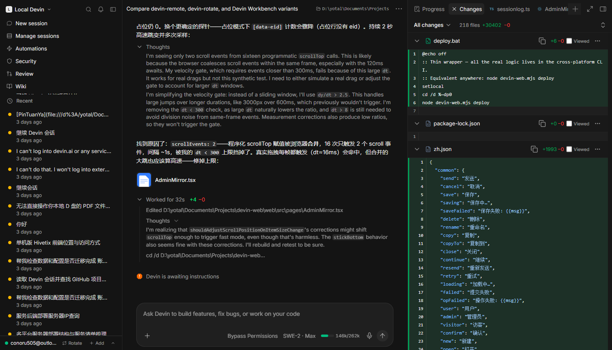
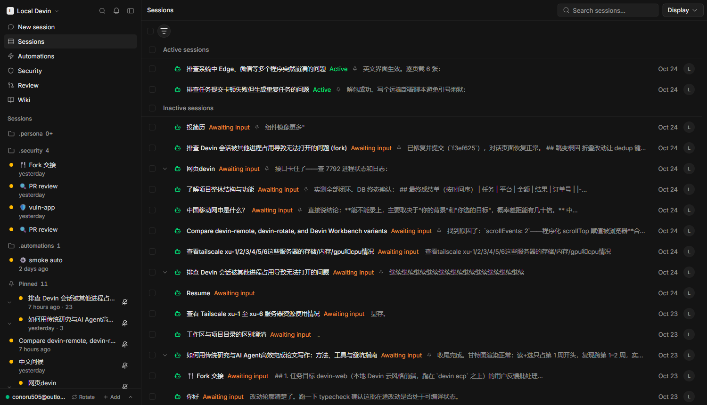
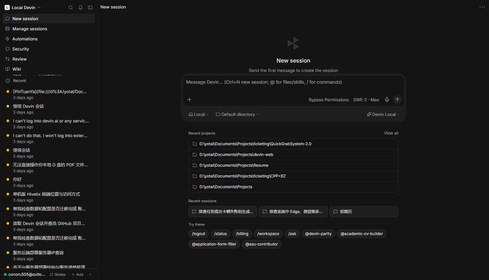
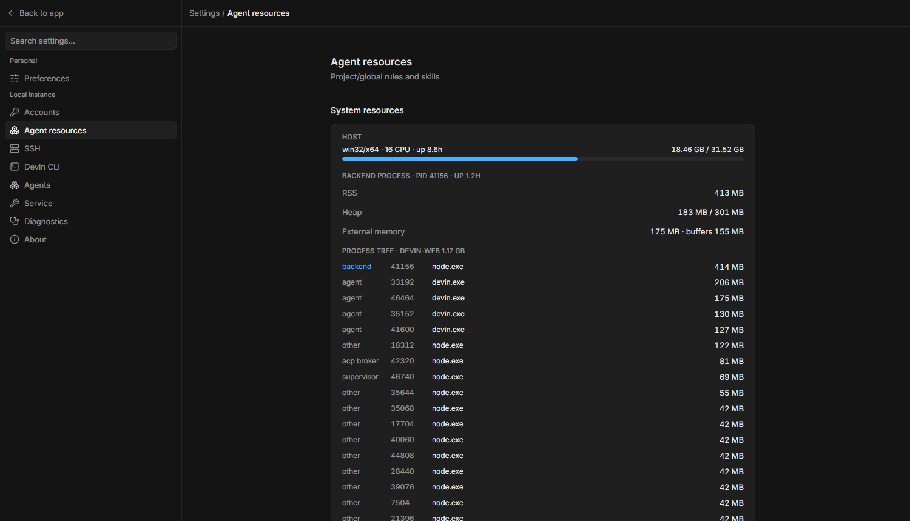
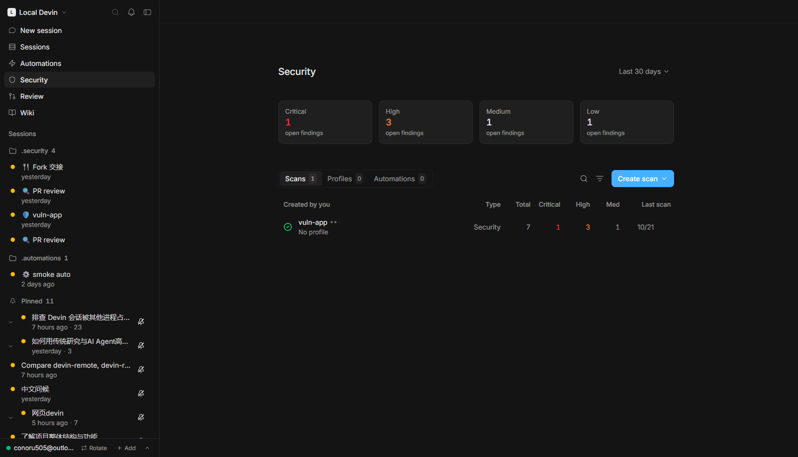
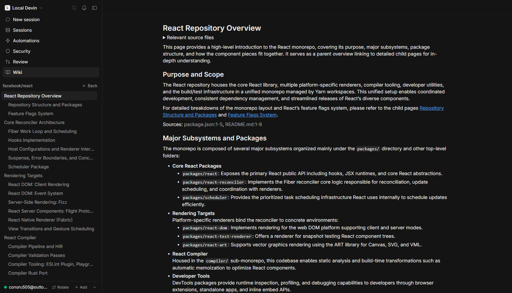

<div align="center">

# devin-web

**A self-hosted Devin control plane for local agents.**

Cloud-style sessions, timeline, editor, terminals and subagents —
driven over the [Agent Client Protocol](https://agentclientprotocol.com),
served from your own machine, reachable anywhere (LAN or Cloudflare Tunnel).

[](LICENSE)
[](README.zh-CN.md)
[](https://nodejs.org)
[](https://github.com/wookat/devin-web)



English · 简体中文 UI — auto-detected from the browser.

</div>

## Why

`devin acp` gives you a protocol endpoint, not a workbench. devin-web is the
workbench: it hosts every local Devin session in a Devin-cloud-style UI —
grouped, searchable, resumable — while surviving backend restarts, browser
refreshes and even agent-process death mid-turn. Turns are journaled to disk
and adopted back on boot; nothing you started is lost.

## Quick start

```bash
git clone https://github.com/wookat/devin-web.git
cd devin-web
npm install
node devin-web.mjs deploy     # build + install boot persistence + start
```

Open **http://localhost:7791** — that's it.

Requirements: Node.js ≥ 22.5 (uses `node:sqlite`, no native deps) and an
authenticated [Devin CLI](https://docs.devin.ai/cli). `cloudflared` is
optional for public access.

```bash
node devin-web.mjs status     # supervisor + backend + persistence state
node devin-web.mjs logs [supervisor|server|broker]
node devin-web.mjs stop       # graceful stop (watchdog respects it)
```

## Features

- **Sessions** — every local Devin session, grouped/searchable, resume with
  full history replay; interrupted turns auto-resume (`open-turns.json`),
  adopted turns keep streaming across restarts.
- **Timeline** — streaming markdown (GFM, KaTeX, Mermaid), thinking blocks,
  per-file diff summaries, permission cards, terminal output.
- **Work panels** — tabbed side panels: progress, changes (syntax-highlighted
  diffs), terminal, live desktop, shell history, todos, kanban, subagents,
  file viewer/editor.
- **Modes & models** — live mode switching (Code / Ask / Plan / Bypass) and
  the full Devin model catalog; option lists survive restarts via the
  persisted `agent-cfg.json` cache.
- **Composer** — `/` command menu, `@` references (workspaces / sessions /
  files / skills), attachments, voice input, drag-and-drop.
- **Multi-account rotation** — SWE rate-limits cool the account and the next
  prompt lands on another identity, on the same pooled acp.
- **Multi-agent & SSH** — pluggable ACP agents (`devin acp` by default,
  presets for opencode and others); SSH run targets pool per
  `agent:ssh:<target>:<cwd>`.
- **Subagents** — `run_subagent` in-session delegation with relay/successor
  handling and derived sidecar transcripts.
- **Security scans** — scheduled/manual scans per workspace with severity
  breakdown and per-finding detail (`/admin/security`).
- **Automations** — preset or custom-cron scheduled sessions
  (`/admin/automations`).
- **Wiki & review** — generated codebase docs with topic tree and DeepWiki
  Q&A (`/admin/wiki`), PR review launcher (`/admin/review`).
- **Durable event store** — `<dataDir>/sessionlog.db` (SQLite, WAL):
  generation-isolated replay, content-addressed blobs dedup large payloads,
  stale-generation sweep on migration + replay end, cached stats.
- **Self-managing deploys** — `POST /api/admin/redeploy` builds then restarts
  immediately; `/_super/restart|stop|status|log` on the supervisor.
- **Access control seam** — `DEVIN_WEB_ADMIN_KEY` gates `/api/admin/*` via the
  existing `x-admin-key` channel (Settings → 服务 → 访问密钥); unset = open
  local mode. `DEVIN_WEB_EDITION` + `featureEnabled()` is the enterprise /
  school / team feature-gate table.
- **Settings** — grouped preferences (general / session / sidebar / accounts
  / agent resources / service / logs / about) at `/settings`.
- **Bilingual UI** — English / 简体中文, browser-detected (`dw-lang`
  localStorage override).

## Screenshots

| | |
|---|---|
|  |  |
| *Session management — grouped list, live status, sort/group/display controls* | *Composer — `/` commands, `@` references, env/model pickers, recent projects* |
|  |  |
| *Settings → Agent resources — live host + per-process memory view* | *Security — scan dashboard, severity breakdown, per-repo findings* |
|  | |
| *Wiki — generated codebase docs, topic tree, DeepWiki Q&A* | |

## Architecture

```
                        ┌─────────────────────────────────────────────┐
cloudflared / browser → │ :7791  supervisor (scripts/supervisor.mjs)  │
                        │         · static frontend (dist/web)        │
                        │         · /api/* + /ws* reverse proxy       │
                        │         · /api/health probe every 4s        │
                        │         · crash / wedge → auto-respawn      │
                        └──────┬───────────────────────┬──────────────┘
                               │ owns                  │ owns
             ┌─────────────────▼─────────┐  ┌──────────▼───────────────┐
             │ :7792 backend             │  │ acp-broker               │
             │ (dist/server/index.js)    │  │ (scripts/acp-broker.mjs) │
             │ · control plane: API,     │◀─┤ · execution plane: owns  │
             │   routing, session state  │  │   every devin acp child  │
             │ · restartable at will     │  │ · long-lived; turns      │
             └───────────────────────────┘  │   stream through it      │
                                            │   NDJSON ctl + raw data  │
                                            └──────────┬───────────────┘
                                                       │ stdio JSON-RPC
                                            ┌──────────▼───────────────┐
                                            │ devin acp / opencode / … │
                                            └──────────────────────────┘
```

Short-lived control plane / long-lived execution plane (the
pgbouncer·tmux·LSP-daemon pattern): the backend may restart, crash or
redeploy at any moment — acp children and their in-flight turns stream
straight through the broker and are re-adopted (`[adopt] n/n re-attached`)
on boot. Three-layer self-healing on top: the **watchdog task** revives the
supervisor, the **supervisor** revives backend and broker, the **broker**
sweeps its own orphaned acp journal. The page stays served even while the
backend is down — APIs return `502 backend_unavailable` until it is back.

### Commit watchdog

The broker bounds the blast radius of upstream agent leaks (e.g. the
≤3000.11.92 `devin acp` PTY leak — ~26 GB committed in 2.5 h, which can
exhaust the *system* commit limit and crash unrelated apps). Every
`DEVIN_WEB_ACP_MEM_SCAN_MS` (30 s) it recycles any acp over
`DEVIN_WEB_ACP_COMMIT_MAX_MB` (8 GB, or 2× while hosting in-flight turns);
if system free commit drops under `DEVIN_WEB_COMMIT_EMERGENCY_MB` (3 GB) it
recycles the fattest child once per scan regardless. Recycles ride the
normal exit path — open turns auto-resume on a fresh acp.

## CLI reference

```bash
node devin-web.mjs deploy     # build + install persistence + smart restart
node devin-web.mjs run        # foreground supervisor (dev mode)
node devin-web.mjs start      # detached supervisor, waits until healthy
node devin-web.mjs stop       # graceful full stop (watchdog respects it)
node devin-web.mjs restart [--build]
node devin-web.mjs status     # supervisor + backend + persistence state
node devin-web.mjs logs [supervisor|server|broker]
node devin-web.mjs install    # platform persistence:
                              #   win32 → Scheduled Tasks (onlogon + 1-min watchdog)
                              #   linux → systemd --user (Restart=always, linger)
                              #   darwin → launchd LaunchAgent (RunAtLoad+KeepAlive)
node devin-web.mjs uninstall
```

`deploy.bat` is a thin Windows wrapper for `deploy`.

## Configuration

All environment variables are optional; sensible defaults for local use.

| Variable | Default | Purpose |
|---|---|---|
| `DEVIN_WEB_DATA_DIR` | `~/.devin-web` | Data directory (logs, db, journals, token) |
| `DEVIN_WEB_PUBLIC_PORT` | `7791` | Supervisor / public port |
| `DEVIN_WEB_BACKEND_PORT` | `7792` | Backend child port (loopback) |
| `DEVIN_WEB_ADMIN_KEY` | *(unset)* | Gate `/api/admin/*` via `x-admin-key`; unset = open local mode |
| `DEVIN_WEB_ALLOWED_HOSTS` | tunnel hosts | Host allowlist for HTTP + WS requests |
| `DEVIN_WEB_EDITION` | `local` | Feature-gate table (`local/team/school/enterprise`) |
| `DEVIN_WEB_ACP_MEM_SCAN_MS` | `30000` | Commit watchdog scan interval (`0` = off) |
| `DEVIN_WEB_ACP_COMMIT_MAX_MB` | `8192` | Per-acp commit ceiling → recycle |
| `DEVIN_WEB_ACP_COMMIT_BUSY_MAX_MB` | `16384` | Ceiling while acp hosts in-flight turns |
| `DEVIN_WEB_COMMIT_EMERGENCY_MB` | `3072` | System free-commit floor → emergency recycle |
| `DEVIN_WEB_FOREIGN_DEVIN_SCAN_MS` | `60000` | Supervisor sweep for devin.exe outside the broker (0=off) |
| `DEVIN_WEB_FOREIGN_DEVIN_MAX_MB` | `16384` | Commit ceiling applied to foreign devin.exe |
| `DEVIN_WEB_LOG_MAX_MB` | `128` | Per-session `.jsonl` rotation size |
| `DEVIN_WEB_TURN_SILENCE_MS` | — | Turn silence settle bound (recovery) |
| `DEVIN_WEB_NO_SUPERVISOR` | — | `1` = bare exit, don't hand :7791 to a supervisor |
| `DEVIN_WEB_DASHBOARD_MCP` | — | `1` = dashboard MCP wrapper instead of file-write |

## Public access

Without `DEVIN_WEB_ADMIN_KEY` the service has **no authentication** — anyone
with the URL has full control. Set it to gate `/api/admin/*`; share/media
paths keep their own tokens either way. We expose it through a Cloudflare
Tunnel; new hostnames must be added to `DEVIN_WEB_ALLOWED_HOSTS`. Prefer
private networks (LAN, tailnet) unless you accept that exposure.

## Development

```bash
npm install
npm run dev         # backend :7781 (tsx watch, bare direct-spawn mode) + web :5173 (vite)
npm run build       # web → dist/web, server → dist/server
npm run typecheck
npm test            # read-only API smoke
node test/broker-smoke.cjs   # acp-broker wire smoke
```

Stack: Node + TypeScript (`@agentclientprotocol/sdk`, `ws`, `node:sqlite`),
React + Vite (Tailwind v4, KaTeX, Mermaid, xterm.js, i18next).

## Docs

- [`AGENTS.md`](AGENTS.md) — operational runbook: restart semantics, recovery
  state machine, broker wire protocol, gotchas
- [`docs/architecture.md`](docs/architecture.md) — module graph, broker
  internals, recovery ledger table

## License

MIT
