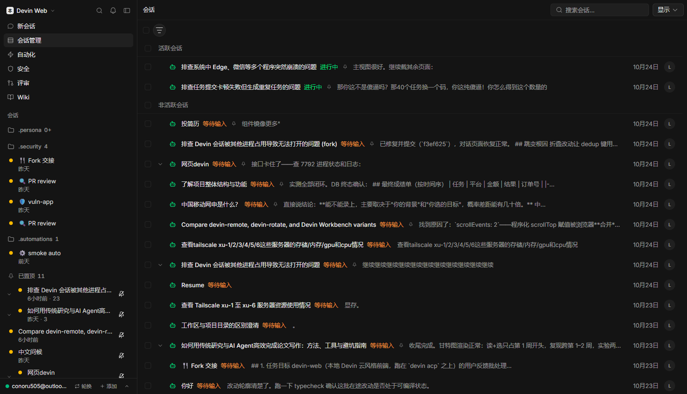
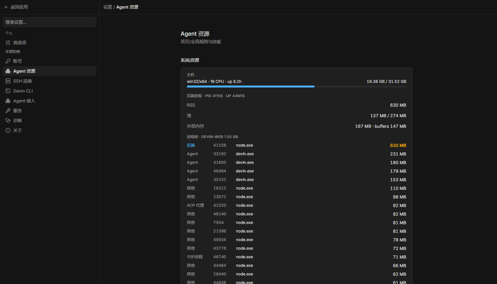
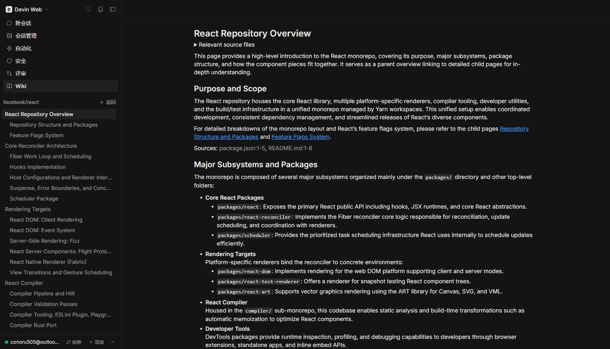

# devin-web

**A self-hosted Devin control plane for local agents** — cloud-style sessions,
timeline, editor, terminals and subagents, driven over the
[Agent Client Protocol](https://agentclientprotocol.com), served from your own
machine and reachable anywhere (LAN or Cloudflare Tunnel).

[](LICENSE)
[](https://nodejs.org)

## Architecture

```
                        ┌─────────────────────────────────────────────┐
cloudflared / browser → │ :7791  supervisor (scripts/supervisor.mjs)  │
                        │         · static frontend (dist/web)        │
                        │         · /api/* + /ws* reverse proxy       │
                        │         · /api/health probe every 4s        │
                        │         · crash / wedge → auto-respawn      │
                        └──────┬───────────────────────┬──────────────┘
                               │ owns                  │ owns
             ┌─────────────────▼─────────┐  ┌──────────▼───────────────┐
             │ :7792 backend             │  │ acp-broker               │
             │ (dist/server/index.js)    │  │ (scripts/acp-broker.mjs) │
             │ · control plane: API,     │◀─┤ · execution plane: owns  │
             │   routing, session state  │  │   every devin acp child  │
             │ · restartable at will     │  │ · long-lived; turns      │
             └───────────────────────────┘  │   stream through it      │
                                            │   NDJSON ctl + raw data  │
                                            └──────────┬───────────────┘
                                                       │ stdio JSON-RPC
                                            ┌──────────▼───────────────┐
                                            │ devin acp / opencode / … │
                                            └──────────────────────────┘
```

Short-lived control plane / long-lived execution plane (the
pgbouncer·tmux·LSP-daemon pattern): the backend may restart, crash or
redeploy at any moment — acp children and their in-flight turns stream
straight through the broker and are re-adopted (`[adopt] n/n re-attached`)
on boot. Three-layer self-healing on top: the **watchdog task** revives the
supervisor, the **supervisor** revives backend and broker, the **broker**
sweeps its own orphaned acp journal. The page stays served even while the
backend is down — APIs return `502 backend_unavailable` until it is back.

## Screenshots

| | |
|---|---|
|  |  |
| *Session detail: streaming timeline + right-side tab panels (changes, terminals, desktop, kanban, subagents, file viewer)* | *Session management: grouped list, search, sort/group/display controls* |
|  |  |
| *New session: composer with `/` commands, `@` references, env/model pickers, recent projects* | *Settings → Agent resources: live host + per-process memory watchdog view* |
|  |  |
| *Security: scan dashboard, severity breakdown, per-repo findings* | *Wiki: generated codebase docs with topic tree and DeepWiki Q&A* |

UI is bilingual — English / 简体中文, auto-detected from the browser
(overridable via `dw-lang` in localStorage).

## The CLI

```bash
node devin-web.mjs deploy     # build + install persistence + smart restart
node devin-web.mjs run        # foreground supervisor (dev mode)
node devin-web.mjs start      # detached supervisor, waits until healthy
node devin-web.mjs stop       # graceful full stop (watchdog respects it)
node devin-web.mjs restart [--build]
node devin-web.mjs status     # supervisor + backend + persistence state
node devin-web.mjs logs [supervisor|server|broker]
node devin-web.mjs install    # platform persistence:
                              #   win32 → Scheduled Tasks (onlogon + 1-min watchdog)
                              #   linux → systemd --user (Restart=always, linger)
                              #   darwin → launchd LaunchAgent (RunAtLoad+KeepAlive)
node devin-web.mjs uninstall
```

`deploy.bat` is a thin Windows wrapper for `deploy`.

## Features

- **Sessions** — every local Devin session, grouped/searchable, resume with
  full history replay; interrupted turns auto-resume (`open-turns.json`),
  adopted turns keep streaming across restarts.
- **Timeline** — streaming markdown (GFM, KaTeX, Mermaid), thinking blocks,
  per-file diff summaries, permission cards, terminal output.
- **Modes & models** — live mode switching and the full Devin model catalog;
  option lists survive restarts via the persisted `agent-cfg.json` cache.
- **Multi-account rotation** — SWE rate-limits cool the account and the next
  prompt lands on another identity, on the same pooled acp.
- **Multi-agent** — pluggable ACP agents (`devin acp` by default; presets for
  opencode and others); SSH run targets pool per `agent:ssh:<target>:<cwd>`.
- **Subagents** — `run_subagent` in-session delegation with relay/successor
  handling and derived sidecar transcripts.
- **Durable event store** — `<dataDir>/sessionlog.db` (SQLite, WAL):
  generation-isolated replay, content-addressed blobs dedup large payloads,
  stale-generation sweep on migration + replay end, cached stats.
- **Commit watchdog** — the broker scans acp children every
  `DEVIN_WEB_ACP_MEM_SCAN_MS` (30s): any child over
  `DEVIN_WEB_ACP_COMMIT_MAX_MB` (8 GB, 2× while hosting in-flight turns) is
  recycled; if system free commit drops under `DEVIN_WEB_COMMIT_EMERGENCY_MB`
  (3 GB) the fattest child goes first. Kills ride the normal exit path →
  turns auto-resume on a fresh acp.
- **Security scans** — scheduled/manual scans per workspace with severity
  breakdown and per-finding detail (`/admin/security`).
- **Automations** — preset or custom-cron scheduled sessions
  (`/admin/automations`).
- **Wiki & review** — generated codebase docs with topic tree and DeepWiki
  Q&A (`/admin/wiki`), PR review launcher (`/admin/review`).
- **Self-managing deploys** — `POST /api/admin/redeploy` builds then restarts
  immediately; `/_super/restart|stop|status|log` on the supervisor.
- **Access control seam** — `DEVIN_WEB_ADMIN_KEY` gates `/api/admin/*` via the
  existing `x-admin-key` channel (Settings → 服务 → 访问密钥); unset = open
  local mode. `DEVIN_WEB_EDITION` + `featureEnabled()` is the enterprise /
  school / team feature-gate table.
- **Settings** — grouped preferences (general / session / sidebar / accounts
  / agent resources / service / logs / about) at `/settings`.

## Requirements

- Node.js ≥ 22.5 (`node:sqlite` — built-in, no native deps)
- [Devin CLI](https://docs.devin.ai/cli) installed and authenticated
- (optional) `cloudflared` for public access

## Public access

Without `DEVIN_WEB_ADMIN_KEY` the service has **no authentication** — anyone
with the URL has full control. Set it to gate `/api/admin/*`; share/media
paths keep their own tokens either way. We expose it through a Cloudflare
Tunnel; new hostnames must be added to `DEVIN_WEB_ALLOWED_HOSTS`. Prefer
private networks (LAN, tailnet) unless you accept that exposure.

## Development

```bash
npm install
npm run dev         # backend :7781 (tsx watch, bare direct-spawn mode) + web :5173 (vite)
npm run build       # web → dist/web, server → dist/server
npm run typecheck
npm test            # read-only API smoke
node test/broker-smoke.cjs   # acp-broker wire smoke
```

Stack: Node + TypeScript (`@agentclientprotocol/sdk`, `ws`, `node:sqlite`),
React + Vite (Tailwind v4, KaTeX, Mermaid, xterm.js).

See `AGENTS.md` for the full module map and operational runbook.

## License

MIT
