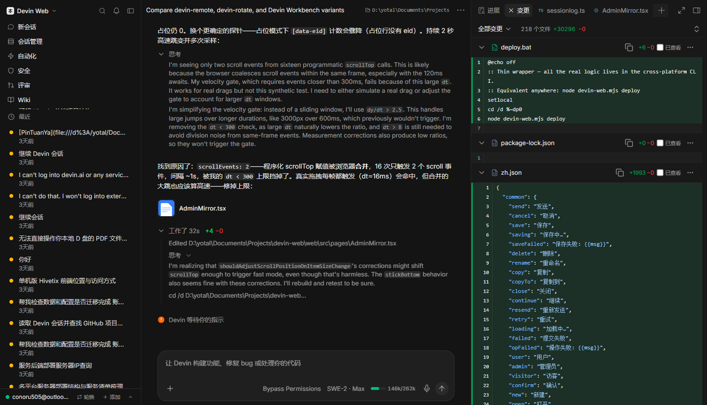
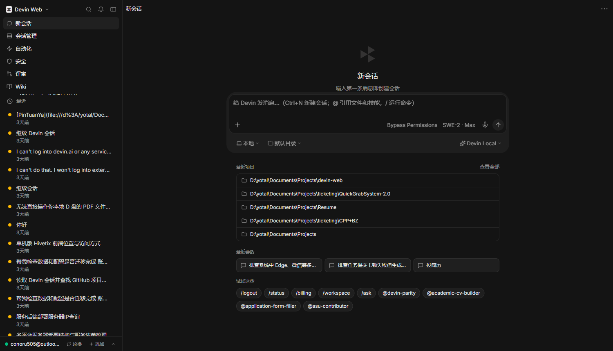
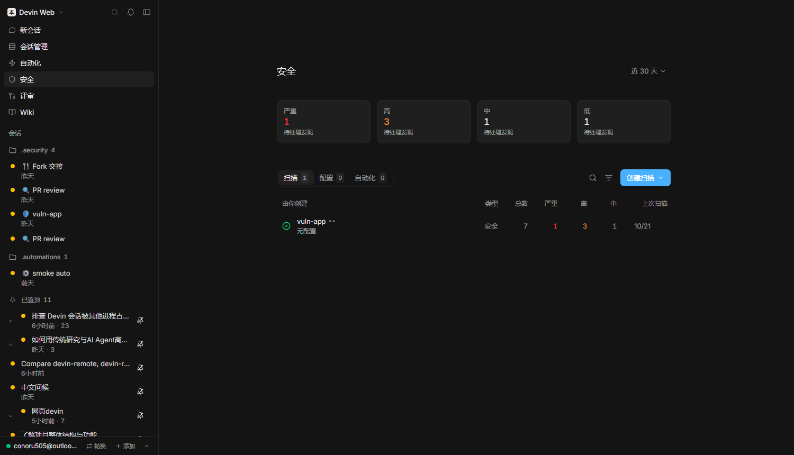

<div align="center">

# devin-web

**自托管的 Devin 本地 Agent 控制平面。**

云端风格的会话、时间线、编辑器、终端与子代理——
基于 [Agent Client Protocol](https://agentclientprotocol.com) 驱动，
由你自己的机器提供服务，随处可达（局域网或 Cloudflare Tunnel）。

[](LICENSE)
[](https://nodejs.org)
[](https://github.com/wookat/devin-web)
[](README.md)



界面支持 中文 · English —— 自动跟随浏览器语言。

</div>

## 为什么做这个项目

`devin acp` 只提供协议端点，不是工作台。devin-web 就是那个工作台：
把本地所有 Devin 会话装进 Devin 云风格的 UI——分组、可搜索、可续聊——
同时扛得住后端重启、浏览器刷新、甚至 Agent 进程中途死亡。回合写盘落
journal，启动时自动领养回来；已开始的工作不会丢。

## 快速开始

```bash
git clone https://github.com/wookat/devin-web.git
cd devin-web
npm install
node devin-web.mjs deploy     # 构建 + 安装开机持久化 + 启动
```

打开 **http://localhost:7791** 即可。

环境要求：Node.js ≥ 22.5（使用内置 `node:sqlite`，无原生依赖）以及已
认证的 [Devin CLI](https://docs.devin.ai/cli)。`cloudflared` 为可选
（公网访问用）。

```bash
node devin-web.mjs status     # supervisor + 后端 + 持久化状态
node devin-web.mjs logs [supervisor|server|broker]
node devin-web.mjs stop       # 优雅停止（看门狗会尊重停机标记）
```

## 功能

- **会话** —— 所有本地 Devin 会话：分组/搜索、完整历史回放续聊；中断
  回合自动恢复（`open-turns.json`），被收养的回合跨重启续流。
- **时间线** —— 流式 Markdown（GFM、KaTeX、Mermaid）、思考块、按文件
  的 diff 摘要、权限卡片、终端输出。
- **工作面板** —— 右侧可切换的标签面板：进展、变更（语法高亮 diff）、
  终端、实时桌面、命令行历史、待办、看板、子代理、文件查看/编辑。
- **模式与模型** —— 会话中实时切换模式（Code / Ask / Plan / Bypass）
  与完整 Devin 模型目录；选项列表经 `agent-cfg.json` 持久化，重启不丢。
- **Composer** —— `/` 命令菜单、`@` 引用（工作区/会话/文件/技能）、
  附件、语音输入、拖拽。
- **多账号轮换** —— SWE 触发限流时当前账号进入冷却，下一条消息落到
  另一个身份上，仍复用同一个池化 acp。
- **多 Agent 与 SSH** —— 可插拔 ACP agent（默认 `devin acp`，内置
  opencode 等预设）；SSH 运行目标按 `agent:ssh:<target>:<cwd>` 池化。
- **子代理** —— 会话内 `run_subagent` 委派，含 relay/successor 处理与
  sidecar 衍生转录。
- **安全扫描** —— 按工作区的定时/手动扫描、严重度分布与逐条发现详情
  （`/admin/security`）。
- **自动化** —— 预设或自定义 cron 的定时会话（`/admin/automations`）。
- **Wiki 与评审** —— 生成的代码库文档（主题树 + DeepWiki 问答，
  `/admin/wiki`）与 PR 评审入口（`/admin/review`）。
- **持久化事件存储** —— `<dataDir>/sessionlog.db`（SQLite, WAL）：
  代际隔离回放、大 payload 内容寻址 blob 去重、迁移与回放收尾时清扫
  过期代、统计缓存。
- **自管理部署** —— `POST /api/admin/redeploy` 构建后立即重启；
  supervisor 提供 `/_super/restart|stop|status|log`。
- **访问控制** —— `DEVIN_WEB_ADMIN_KEY` 通过既有的 `x-admin-key` 通道
  守住 `/api/admin/*`（设置 → 服务 → 访问密钥）；不设置 = 开放本地模式。
  `DEVIN_WEB_EDITION` + `featureEnabled()` 是企业版/校园版/团队版的
  功能开关表。
- **设置** —— `/settings` 分组偏好：通用 / 会话 / 侧栏 / 账号 /
  Agent 资源 / 服务 / 日志 / 关于。
- **中英双语 UI** —— 跟随浏览器语言（localStorage `dw-lang` 可覆盖）。

## 截图

| | |
|---|---|
|  |  |
| *会话管理 —— 分组列表、实时状态、排序/分组/显示控制* | *Composer —— `/` 命令、`@` 引用、环境/模型选择、最近项目* |
|  |  |
| *设置 → Agent 资源 —— 主机 + 逐进程内存实时视图* | *安全 —— 扫描面板、严重度分布、按仓库的发现* |
|  | |
| *Wiki —— 生成的代码库文档、主题树、DeepWiki 问答* | |

## 架构

```
                        ┌─────────────────────────────────────────────┐
cloudflared / 浏览器  → │ :7791  supervisor (scripts/supervisor.mjs)  │
                        │         · 静态前端 (dist/web)               │
                        │         · /api/* + /ws* 反向代理            │
                        │         · /api/health 每 4s 探活            │
                        │         · 崩溃 / 卡死 → 自动重生            │
                        └──────┬───────────────────────┬──────────────┘
                               │ 拥有                  │ 拥有
             ┌─────────────────▼─────────┐  ┌──────────▼───────────────┐
             │ :7792 后端                │  │ acp-broker               │
             │ (dist/server/index.js)    │  │ (scripts/acp-broker.mjs) │
             │ · 控制面：API、路由、     │◀─┤ · 执行面：拥有所有本地   │
             │   会话状态；可随意重启    │  │   devin acp 子进程       │
             └───────────────────────────┘  │ · 长驻；回合流穿它而过   │
                                            │   NDJSON 控制 + 裸数据   │
                                            └──────────┬───────────────┘
                                                       │ stdio JSON-RPC
                                            ┌──────────▼───────────────┐
                                            │ devin acp / opencode / … │
                                            └──────────────────────────┘
```

短命控制面 / 长命执行面（pgbouncer·tmux·LSP-daemon 模式）：后端可以
随时重启、崩溃或热部署——acp 子进程与在途回合直接经 broker 流转，启动时
被收养（`[adopt] n/n re-attached`）。其上还有三层自愈：**看门狗任务**
复活 supervisor，**supervisor** 复活后端与 broker，**broker** 清扫自己
journal 里的孤儿 acp。后端挂掉期间页面仍可打开——API 返回
`502 backend_unavailable` 直到恢复。

### Commit 看门狗

broker 为上游 agent 泄漏兜底（例如 ≤3000.11.92 的 `devin acp` PTY 泄漏
——2.5 小时吃掉 ~26 GB commit，可耗尽**系统级** commit 上限并拖垮无关
应用）。每 `DEVIN_WEB_ACP_MEM_SCAN_MS`（30s）扫描一次：超过
`DEVIN_WEB_ACP_COMMIT_MAX_MB`（8 GB；承载在途回合时放宽到 2×）的 acp
被回收；若系统剩余 commit 跌破 `DEVIN_WEB_COMMIT_EMERGENCY_MB`（3 GB），
则每轮无条件回收最胖的一个。回收走正常退出路径——在途回合自动在新 acp
上恢复。

## CLI 参考

```bash
node devin-web.mjs deploy     # 构建 + 持久化 + 智能重启
node devin-web.mjs run        # 前台 supervisor（开发模式）
node devin-web.mjs start      # 后台 supervisor，等待健康后返回
node devin-web.mjs stop       # 优雅全停（看门狗尊重停机标记）
node devin-web.mjs restart [--build]
node devin-web.mjs status     # supervisor + 后端 + 持久化状态
node devin-web.mjs logs [supervisor|server|broker]
node devin-web.mjs install    # 平台持久化：
                              #   win32 → 计划任务（登录启动 + 每分钟看门狗）
                              #   linux → systemd --user（Restart=always + linger）
                              #   darwin → launchd LaunchAgent（RunAtLoad+KeepAlive）
node devin-web.mjs uninstall
```

`deploy.bat` 是 `deploy` 的 Windows 薄封装。

## 配置项

所有环境变量均可选；本地使用即合理默认。

| 变量 | 默认值 | 用途 |
|---|---|---|
| `DEVIN_WEB_DATA_DIR` | `~/.devin-web` | 数据目录（日志、db、journal、token） |
| `DEVIN_WEB_PUBLIC_PORT` | `7791` | supervisor / 对外端口 |
| `DEVIN_WEB_BACKEND_PORT` | `7792` | 后端子进程端口（仅回环） |
| `DEVIN_WEB_ADMIN_KEY` | *(未设置)* | 以 `x-admin-key` 守住 `/api/admin/*`；未设 = 开放本地模式 |
| `DEVIN_WEB_ALLOWED_HOSTS` | tunnel 主机 | HTTP + WS 请求的 Host 白名单 |
| `DEVIN_WEB_EDITION` | `local` | 功能开关表（`local/team/school/enterprise`） |
| `DEVIN_WEB_ACP_MEM_SCAN_MS` | `30000` | commit 看门狗扫描间隔（`0` = 关） |
| `DEVIN_WEB_ACP_COMMIT_MAX_MB` | `8192` | 单 acp commit 上限 → 回收 |
| `DEVIN_WEB_ACP_COMMIT_BUSY_MAX_MB` | `16384` | 承载在途回合时的上限 |
| `DEVIN_WEB_COMMIT_EMERGENCY_MB` | `3072` | 系统剩余 commit 底线 → 紧急回收 |
| `DEVIN_WEB_LOG_MAX_MB` | `128` | 单会话 `.jsonl` 轮转大小 |
| `DEVIN_WEB_TURN_SILENCE_MS` | — | 回合静默结算上限（恢复用） |
| `DEVIN_WEB_NO_SUPERVISOR` | — | `1` = 裸退出，不把 :7791 交给 supervisor |
| `DEVIN_WEB_DASHBOARD_MCP` | — | `1` = 启用 dashboard MCP 封装而非文件直写 |

## 公网访问

不设置 `DEVIN_WEB_ADMIN_KEY` 时服务**没有鉴权**——拿到 URL 的人就有完全
控制权。设置它以守住 `/api/admin/*`；share/media 路径无论何时都有自己
的 token。我们通过 Cloudflare Tunnel 对外暴露；新主机名需要加入
`DEVIN_WEB_ALLOWED_HOSTS`。除非你接受这种暴露面，否则优先私有网络
（局域网、tailnet）。

## 开发

```bash
npm install
npm run dev         # 后端 :7781 (tsx watch, 裸直接 spawn 模式) + web :5173 (vite)
npm run build       # web → dist/web, server → dist/server
npm run typecheck
npm test            # 只读 API 冒烟
node test/broker-smoke.cjs   # acp-broker 线路冒烟
```

技术栈：Node + TypeScript（`@agentclientprotocol/sdk`、`ws`、
`node:sqlite`），React + Vite（Tailwind v4、KaTeX、Mermaid、xterm.js、
i18next）。

## 文档

- [`AGENTS.md`](AGENTS.md) —— 运行手册：重启语义、恢复状态机、broker
  线路协议、各种坑
- [`docs/architecture.md`](docs/architecture.md) —— 模块图、broker 内部
  机制、恢复 ledger 表

## License

MIT
